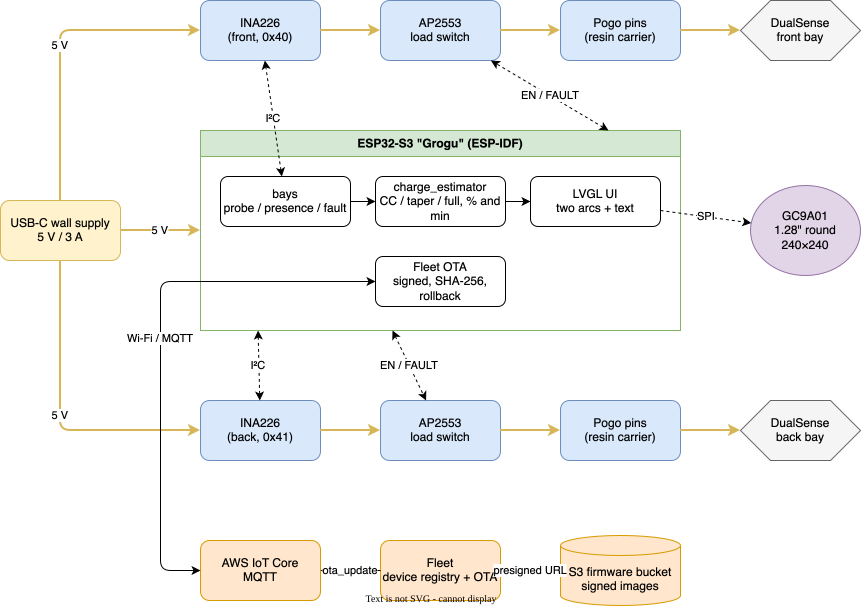

# controller-stand — a slide-on charging stand for two PS5 DualSense controllers

## Support

If you find this useful, please consider buying me a coffee:

[](https://www.paypal.com/donate?hosted_button_id=Q3BESC73EWVNN&custom=controller-stand)

## Table of Contents

<!-- toc -->

- [Why](#why)
- [Architecture Diagram](#architecture-diagram)
- [Repository Layout](#repository-layout)
- [Hardware](#hardware)
- [Building the firmware](#building-the-firmware)
- [Acknowledgements](#acknowledgements)
- [Architecture Diagrams](#architecture-diagrams)
- [Support](#support)

<!-- tocstop -->

## Why

The official DualSense charging station works, but getting a controller on and off it is
fiddly: the cradles are shallow and the pogo pins only meet the pads if the controller goes
down at just the right angle. This stand aims to let a controller slide on and off in one
movement, and to tell you how charged each one is.

The stand holds two controllers, one behind the other. An ESP32-S3 ("Grogu") watches
the charge current in each bay and shows it on a 1.28" round display:

```
Front  ~60%  40 min to full
Back   100%
```

The DualSense's dock pads carry power and a sense line, not data, so the controller cannot
report its own battery level. The percentage is **estimated** from the shape of the charge
curve (constant current, then a tapering constant voltage) and the energy delivered since
docking, hence the `~`.

## Architecture Diagram



## Repository Layout

| Path | What |
|---|---|
| `firmware/` | ESP-IDF project for the ESP32-S3: bay sensing, charge estimator, GC9A01 round-display UI (LVGL) |
| `firmware/components/charge_estimator/` | Pure C charge-state estimator, no IDF dependencies |
| `firmware/test/host/` | Host-run unit tests for the estimator (CMake + CTest) |
| `hardware/` | Wiring, bill of materials, connector notes |
| `cad/` | Exported printable parts and the measurements the CAD is built from |
| `tools/` | Helper scripts (charge-log capture, measurement extraction) |
| `docs/` | Architecture diagram, logo |

## Hardware

- ESP32-S3 dev board
- 1.28" round GC9A01 240×240 SPI TFT
- 2 × INA226 current/voltage monitors (one per bay)
- 2 × current-limited high-side load switches (AP2553 or similar): the pogo pins stay
  unpowered until a controller is detected
- Pogo pins in a resin-printed carrier, body printed in PLA
- USB-C panel socket, fed from a 5 V / 3 A wall supply

See [`hardware/README.md`](hardware/README.md) for wiring.

## Building the firmware

```bash
cd firmware
idf.py set-target esp32s3
idf.py build flash monitor
```

Host tests for the estimator (no hardware needed):

```bash
cmake -S firmware/test/host -B firmware/test/host/build
cmake --build firmware/test/host/build
ctest --test-dir firmware/test/host/build --output-on-failure
```

## Acknowledgements

The controller's underside dimensions (section profiles, outline, connector position) were
measured from [PS5 DualSense Controller Stand V2](https://www.printables.com/model/466653)
by Conrad Jun (Printables, CC BY-NC 4.0). Only measurements were taken: no mesh, surface or
file from that model is included here, and all geometry in this repository is drawn afresh.

## Architecture Diagrams

`docs/architecture/controller-stand.drawio` is the source for the diagram above.
The SVG is auto-regenerated on commit by the pre-commit hook in `.githooks/pre-commit`.

To activate the hook after cloning:

```bash
git config core.hooksPath .githooks
```

## Support

If you find this useful, please consider buying me a coffee:

[](https://www.paypal.com/donate?hosted_button_id=Q3BESC73EWVNN&custom=controller-stand)
